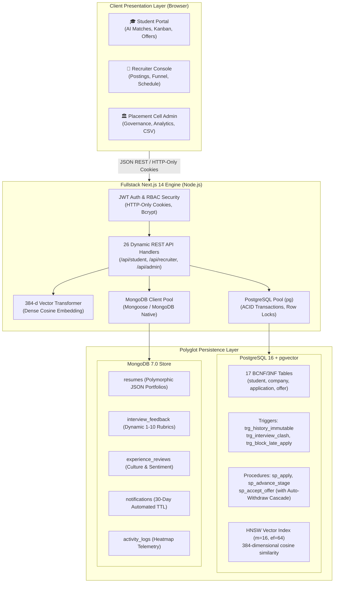

<div align="center">

# 🎯 InternTrack
### Next-Gen Internship Lifecycle Management & Semantic Matching Platform

[](https://www.postgresql.org/)
[](https://github.com/pgvector/pgvector)
[](https://www.mongodb.com/)
[](https://nextjs.org/)
[](https://nodejs.org/)
[](https://pes.edu)

<br/>

**A production-grade, polyglot campus placement platform powered by PostgreSQL 16 + pgvector and MongoDB 7.0.**  
*Enforces university bylaws, atomic offer acceptance cascades, interview collision detection, and AI semantic vector matching.*

<br/>

[Explore Architecture](#-architecture--polyglot-engine) •
[Quickstart](#-quickstart-in-3-minutes) •
[Demo Portals](#-role-based-demo-portals) •
[Test Suite](#-automated-test-suite-1616-passing) •
[Docs Index](#-academic-documentation)

<br/>
<br/>

---

</div>

## ⚡ Why InternTrack?

Managing university recruitment drives for thousands of students and hundreds of corporate partners is fraught with compliance violations and operational friction:

- ❌ **Offer Hoarding:** Students acquire offers and fail to withdraw active applications, denying peers interview slots.
- ❌ **Interview Schedule Collisions:** Recruiters independently book shared candidates into overlapping time slots.
- ❌ **Keyword Matching Blindspots:** Keyword searches miss high-potential students with alternative technical jargon.
- ❌ **Relational Rigidity vs Unstructured Resumes:** Complex student portfolios and dynamic evaluation rubrics break strict tabular schemas.

**InternTrack** resolves this with an **Institutional Polyglot Architecture**:

| Capability | Engineering Solution | Database Tier |
|---|---|---|
| **ACID Integrity & 3NF/BCNF** | 17 normalized tables with domain checks and foreign key referential actions | `PostgreSQL 16` |
| **High-Dimensional Semantic Search** | 384-d dense vectors with HNSW cosine distance index (`<=>`) | `pgvector` |
| **Concurrency & Cascade Rules** | Atomic stored procedures with `SELECT ... FOR UPDATE` pessimistic locks | `PL/pgSQL` |
| **Real-Time Temporal Overlaps** | Interval overlap triggers (`(start, end) OVERLAPS (...)`) | `PostgreSQL Triggers` |
| **Polymorphic Resumes & Rubrics** | Unstructured JSON documents, multi-criteria evaluations | `MongoDB 7.0` |
| **Automated Storage Cleanup** | 30-day Time-To-Live (TTL) index on notifications | `MongoDB TTL` |
| **Curriculum Gap Analytics** | Materialized view (`mv_skill_demand`) refreshed concurrently | `PostgreSQL MV` |

---

## 🏛️ Architecture & Polyglot Engine



---

## 🚀 Quickstart in 3 Minutes

### 1. Prerequisites
- [Node.js](https://nodejs.org/) v18.0.0 or higher
- [Docker Desktop](https://www.docker.com/products/docker-desktop/) installed & running

### 2. Clone & Spin up Containers
```bash
git clone https://github.com/your-username/interntrack.git
cd interntrack

# Start PostgreSQL 16 (pgvector) and MongoDB 7.0
docker compose up -d

# Verify containers are healthy
docker ps --format "table {{.Names}}\t{{.Status}}\t{{.Ports}}"
```

### 3. Initialize Database & Seed
```bash
# 1. Apply 17-table schema, indexes, views, triggers, and stored procedures
npm run db:migrate

# 2. Seed realistic students, 384-d vectors, postings, resumes, and reviews
npm run db:seed
```

### 4. Run Automated Test Suite
```bash
npm test
```
> **Output:** `pass 16, fail 0` — All relational constraints, triggers, pessimistic locks, vector searches, and MongoDB aggregations verified.

### 5. Launch the Platform
```bash
npm run dev
```
Open **[http://localhost:3000](http://localhost:3000)** in your browser.

---

## 🎭 Role-Based Demo Portals

The landing page features a **1-Click Evaluator Demo Switcher** for instant testing:

```
+-----------------------------------------------------------------------------------+
|  [ 🔵 Launch Student Portal ]   [ 🟢 Launch Recruiter Portal ]   [ 🟡 Launch Admin ]|
+-----------------------------------------------------------------------------------+
```

| Portal | Email | Password | What to Test |
|---|---|---|---|
| **Student (Placed)** | `aditi@pesu.pes.edu` | `password123` | View AI semantic recommendations (`91.85% Match`), check Kanban pipeline, test locked placed status. |
| **Student (Unplaced)** | `rohan@pesu.pes.edu` | `password123` | Apply to openings, inspect interview schedules, accept offers with atomic cascading withdrawal. |
| **Recruiter (Google)** | `vikram@google.com` | `password123` | Applicant funnel, trigger `sp_advance_stage`, find similar candidates via vector proximity. |
| **Recruiter (Microsoft)** | `priya@microsoft.com` | `password123` | Schedule interviews, test clash detection trigger, issue formal compensation offers. |
| **Placement Cell Admin** | `admin@pesu.pes.edu` | `adminpassword` | Vetting queue, policy tuning, `mv_skill_demand` refresh, download official NAAC/NBA CSV exports. |

---

## 🧪 Automated Test Suite (16/16 Passing)

InternTrack includes an automated test harness in [`tests/interntrack.test.js`](file:///Users/Sumukh_Shandilya/Documents/PES%20UNIVERSITY/V%20SEM/DBMS/Mini-Project/tests/interntrack.test.js) executed via `npm test`:

```
✔ 1.1 Schema Constraint: Block invalid student CGPA > 10.00
✔ 1.2 Schema Constraint: Block duplicate application for same student and posting
✔ 1.3 Schema Constraint: Block posting filled count exceeding openings
✔ 1.4 Schema Constraint: Block invalid email format in app_user
✔ 2.1 Trigger trg_history_immutable: Strictly block UPDATE on application_stage_history
✔ 2.2 Trigger trg_history_immutable: Strictly block DELETE on audit_log
✔ 2.3 Trigger trg_block_late_apply: Block application if posting is closed or deadline passed
✔ 2.4 Trigger trg_interview_clash: Detect and block overlapping interview schedule
✔ 3.1 sp_apply: Reject application if student CGPA is below cutoff
✔ 3.2 sp_advance_stage: Block illegal stage transition from Applied directly to Accepted
✔ 3.3 sp_issue_offer: Issue offer and advance application stage to Offered
✔ 3.4 sp_accept_offer & University Cascade Policy: Concurrency-safe acceptance auto-withdraws other active apps
✔ 4.1 Concurrency: Prevent race condition claiming last opening with SELECT ... FOR UPDATE
✔ 5.1 pgvector: Cosine distance calculation with 384-dimensional vectors
✔ 6.1 MongoDB Aggregation: Average Rating per Company
✔ 6.2 MongoDB Aggregation: Resume Skills Frequency
✔ 6.3 MongoDB Aggregation: Interview Rubric Dynamic Keys
✔ 7.1 Auth: Password hashing and verification with bcrypt
✔ 7.2 Auth: JWT Token signing, verification, and role payload
```

---

## 📊 In-Depth Database Features

### 1. Atomic Offer Acceptance & Cascade (`sp_accept_offer`)
When a student accepts an offer, InternTrack prevents race conditions using **pessimistic row-level locking**:
```sql
-- Lock target posting row to serialize concurrent applicants
SELECT filled_openings, total_openings FROM internship_posting WHERE posting_id = v_posting_id FOR UPDATE;

-- Update status and mark student placed
UPDATE offer SET status = 'accepted' WHERE offer_id = p_offer_id;
UPDATE student SET is_placed = TRUE WHERE student_id = p_student_id;

-- University Cascade Policy: Auto-withdraw all competing active applications
UPDATE application SET current_stage = 'Withdrawn'
WHERE student_id = p_student_id AND application_id != v_app_id
  AND current_stage IN ('Applied', 'Shortlisted', 'Interview', 'Offered');
```

### 2. High-Dimensional Vector Search (pgvector)
PostgreSQL performs native nearest-neighbor retrieval using an **HNSW index** with cosine distance:
```sql
SELECT 
  p.posting_id, p.title, c.name,
  ROUND(((1 - (p.embedding <=> s.profile_embedding)) * 100)::NUMERIC, 2) AS semantic_match_score
FROM internship_posting p
JOIN company c ON p.company_id = c.company_id
CROSS JOIN student s
WHERE s.student_id = $1 AND p.status = 'Active' AND s.cgpa >= p.min_cgpa
ORDER BY p.embedding <=> s.profile_embedding ASC
LIMIT 10;
```

### 3. Five Production MongoDB Aggregation Pipelines
- **Company Sentiment:** `$group` on ratings across 4 dimensions (overall, WLB, learning curve, stipend).
- **Skills Intelligence:** `$unwind: '$skills'` to compute university-wide competency frequency.
- **Dynamic Rubrics:** `$objectToArray` to unpack and average variable role criteria (e.g. `System Design`, `Coding`).
- **Telemetry Heatmap:** `$hour: '$timestamp'` grouping user traffic for institutional capacity planning.
- **Corporate Culture Tags:** `$sortByCount: '$tags'` surfacing top student sentiment badges.

---

## 📚 Academic Documentation

Every aspect of this project is documented in the [`docs/`](./docs) folder:

| Document | Topic |
|---|---|
| [**01_objectives.md**](./docs/01_objectives.md) | Problem Statement, Challenges, and Core Objectives (O1–O8) |
| [**02_functional_requirements.md**](./docs/02_functional_requirements.md) | Functional Requirements Matrix (FR-S1 through FR-X5) |
| [**03_er_diagram.md**](./docs/03_er_diagram.md) | Conceptual Schema, Mermaid ER Diagram, and Cardinality Ratios |
| [**04_relational_schema.md**](./docs/04_relational_schema.md) | 17 Table Definitions & Formal BCNF Functional Dependency Proof |
| [**05_db_choice_justification.md**](./docs/05_db_choice_justification.md) | Relational vs NoSQL vs pgvector Polyglot Architecture Rationale |
| [**06_data_dictionary.md**](./docs/06_data_dictionary.md) | Complete Data Dictionary for 17 Tables and 6 MongoDB Collections |
| [**07_sql_implementation.md**](./docs/07_sql_implementation.md) | Complete DDL, Triggers, Stored Procedures, and Locking Details |
| [**08_nosql_vector_implementation.md**](./docs/08_nosql_vector_implementation.md) | 5 MongoDB Aggregation Pipelines & HNSW Vector Indexing Guide |
| [**09_important_queries.md**](./docs/09_important_queries.md) | 15+ Advanced Curated Queries (Joins, CTEs, Window Functions, Vectors) |
| [**10_architecture.md**](./docs/10_architecture.md) | System Architecture & End-to-End Workflow Sequence Diagrams |
| [**12_testing_results.md**](./docs/12_testing_results.md) | 16-Test Verification Report, Concurrency Logs, and Invariants |
| [**13_conclusion.md**](./docs/13_conclusion.md) | Evaluation Rubric Checklist, Limitations, and Future Roadmap |
| [**DEMO_GUIDE.md**](./DEMO_GUIDE.md) | Rubric-Mapped Step-by-Step Evaluator Walkthrough Guide |
| [**VIVA_GUIDE.md**](./VIVA_GUIDE.md) | Technical Viva Preparation: Questions, Answers, & Database Theory |

---

## 🛠️ Project Structure

```
├── app/                              # Next.js 14 App Router
│   ├── admin/                        # Placement Cell Admin Console
│   ├── api/                          # 26 Dynamic REST API Route Handlers
│   ├── recruiter/                    # Recruiter Management Portal
│   ├── student/                      # Student Self-Service Portal
│   ├── globals.css                   # Custom Dark Glassmorphism Styling
│   └── page.js                       # Landing Page with 1-Click Demo Switcher
├── db/                               # Relational Schema & Migrations
│   └── migrations/                   # 001_init to 005_alter_demo + 006_seed
├── docs/                             # Complete Academic Documentation Reports (01–13)
├── lib/                              # Core Drivers & Business Logic
│   ├── aggregations.js               # 5 MongoDB Aggregation Pipelines
│   ├── auth.js                       # JWT, Bcrypt, & RBAC Middleware
│   ├── db.js                         # PostgreSQL Pool & Transaction Helpers
│   ├── embeddings.js                 # 384-d Dense Semantic Vector Generator
│   └── mongo.js                      # MongoDB Client & 30-Day TTL Indexes
├── scripts/                          # DevOps Automation
│   ├── migrate.js                    # Sequential SQL Migration Runner
│   └── seed.js                       # Polyglot Seeder (Postgres + Mongo + Vectors)
├── tests/                            # Automated Verification
│   └── interntrack.test.js           # 16 Unit & Concurrency Automated Tests
├── docker-compose.yml                # Multi-Container PostgreSQL + MongoDB Stack
├── DEMO_GUIDE.md                     # Evaluator Walkthrough Guide
├── VIVA_GUIDE.md                     # Technical Viva Preparation
└── README.md                         # Project Master Documentation
```

---

<div align="center">

Developed by Sumukh Shandilya!
</div>
