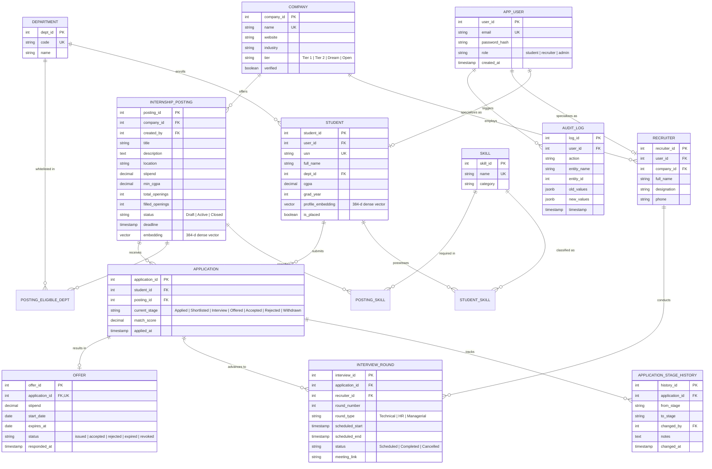

# InternTrack — Entity-Relationship (ER) Diagram & Conceptual Schema

**Course:** Database Management Systems (UE22CS341AA / UE23CS351AA) — Experiential Learning Level 3  
**Institution:** PES University, Department of Computer Science and Engineering  

---

## 1. Conceptual ER Modeling Overview

InternTrack models the complete university internship placement lifecycle. The data model distinguishes between:
1. **Core Relational Entities (PostgreSQL):** Users, Students, Recruiters, Companies, Departments, Skills, Internship Postings, Applications, Interviews, Offers, Audit Logs, and Placement Policies.
2. **Semi-Structured Document Entities (MongoDB):** Resumes, Posting Documents, Interview Feedback Rubrics, Experience Reviews, Notifications, and Activity Logs.
3. **High-Dimensional Vector Attributes (pgvector):** Dense 384-dimensional semantic embeddings stored directly on `student.profile_embedding` and `internship_posting.embedding`.

---

## 2. Mermaid Entity-Relationship Diagram

---

## 3. Cardinality Ratios & Participation Constraints

| Relationship | Cardinality Ratio | Student / Posting Participation | Justification |
|---|---|---|---|
| `APP_USER` ➔ `STUDENT` | $1 : (0..1)$ | Total for student users; Partial for admin/recruiter. | Every student profile requires exactly one authentication account. |
| `APP_USER` ➔ `RECRUITER` | $1 : (0..1)$ | Total for recruiters; Partial for admin/student. | Recruiters authenticate through `app_user` before linking to a company. |
| `COMPANY` ➔ `RECRUITER` | $1 : N$ | Partial for company; Total for recruiter. | A company may have multiple recruiting officers; each recruiter belongs to one company. |
| `DEPARTMENT` ➔ `STUDENT` | $1 : N$ | Total for student; Partial for department. | Every student must be enrolled in exactly one academic department. |
| `COMPANY` ➔ `INTERNSHIP_POSTING` | $1 : N$ | Total for posting; Partial for company. | A posting is authored by exactly one company; a company can issue multiple postings. |
| `STUDENT` ➔ `APPLICATION` | $1 : N$ | Partial for student; Total for application. | A student can apply to zero or many postings (bounded by policy); an application must be tied to a student. |
| `INTERNSHIP_POSTING` ➔ `APPLICATION` | $1 : N$ | Total for application; Partial for posting. | A posting can receive zero or many candidate applications. |
| `APPLICATION` ➔ `OFFER` | $1 : (0..1)$ | Partial for application; Total for offer. | An application receives at most one formal offer (`UNIQUE (application_id)`). |
| `APPLICATION` ➔ `APPLICATION_STAGE_HISTORY` | $1 : N$ | Total (Weak identification). | Stage history rows cannot exist without a parent application (`ON DELETE CASCADE`). |
| `INTERVIEW_ROUND` ➔ `APPLICATION` | $N : 1$ | Total for interview; Partial for application. | An interview belongs to one candidate application; an application can undergo multiple rounds. |

---

## 4. Weak Entity Identification

- **`APPLICATION_STAGE_HISTORY`**: Represents a temporal weak entity dependent on the `APPLICATION` identifying owner. If an application record is purged, its corresponding stage progression audit records cascade (`ON DELETE CASCADE`), though during normal runtime updates, `trg_history_immutable` prevents modification or deletion.
- **`POSTING_ELIGIBLE_DEPT` & `POSTING_SKILL`**: Associative bridge entities with composite primary keys:
  - `(posting_id, dept_id)`
  - `(posting_id, skill_id)`
- **`STUDENT_SKILL`**: Associative bridge entity with composite primary key:
  - `(student_id, skill_id)`
