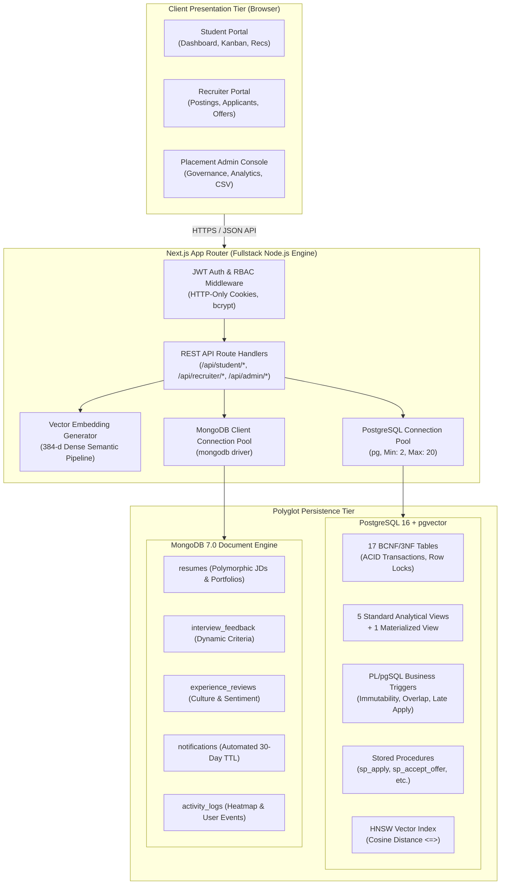
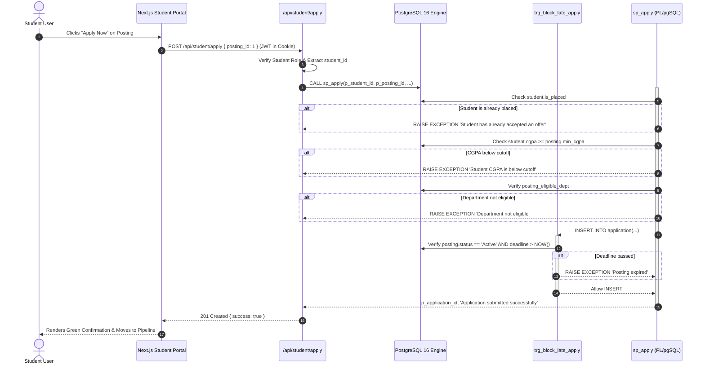
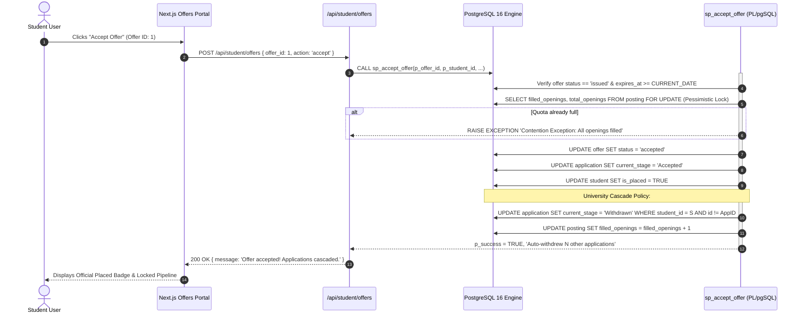

# InternTrack — System Architecture & Data Flow Design

**Course:** Database Management Systems (UE22CS341AA / UE23CS351AA) — Experiential Learning Level 3  
**Institution:** PES University, Department of Computer Science and Engineering  

---

## 1. High-Level Multi-Tier Architecture

InternTrack uses a modern, high-performance polyglot architecture separating presentation, server-side business logic, transactional persistence, unstructured document storage, and vector retrieval.

---

## 2. End-to-End Data Flow Workflows

### 2.1 Workflow 1: Eligibility-Checked Application Submission (`sp_apply`)

---

### 2.2 Workflow 2: Atomic Offer Acceptance & Cascade (`sp_accept_offer`)

---

## 3. Concurrency & Security Architecture

1. **Authentication & Session Tokens:**
   - Stateless JWT tokens signed with HMAC-SHA256 containing `userId`, `email`, `role`, and `subId` (student_id or recruiter_id).
   - Stored in browser `httpOnly`, `sameSite: 'lax'`, `secure: false` (local dev) cookies to prevent XSS credential theft.
   - Passwords salted and hashed with `bcrypt` (10 rounds).

2. **Pessimistic Concurrency Control:**
   - `SELECT ... FOR UPDATE` acquires an exclusive row lock on the target `internship_posting` record inside transaction boundaries.
   - Any concurrent request attempting to accept an offer for the final opening is serialized and blocked until the first transaction commits, preventing overselling seats.

3. **Database Security & RBAC:**
   - Relational check constraints and foreign keys protect against SQL injection and application bugs.
   - Parameterized queries (`$1, $2, ...`) utilized universally across all PostgreSQL queries.
